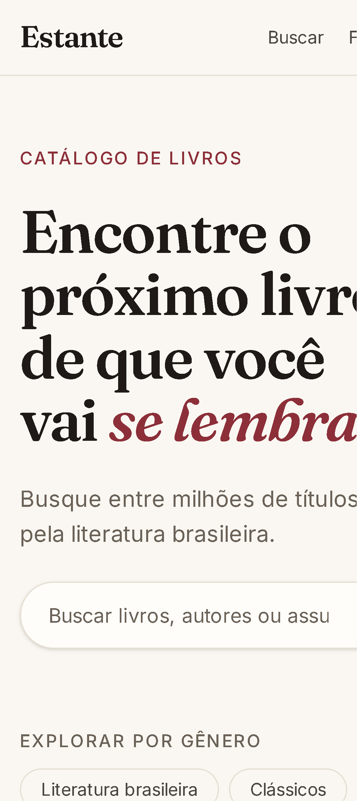
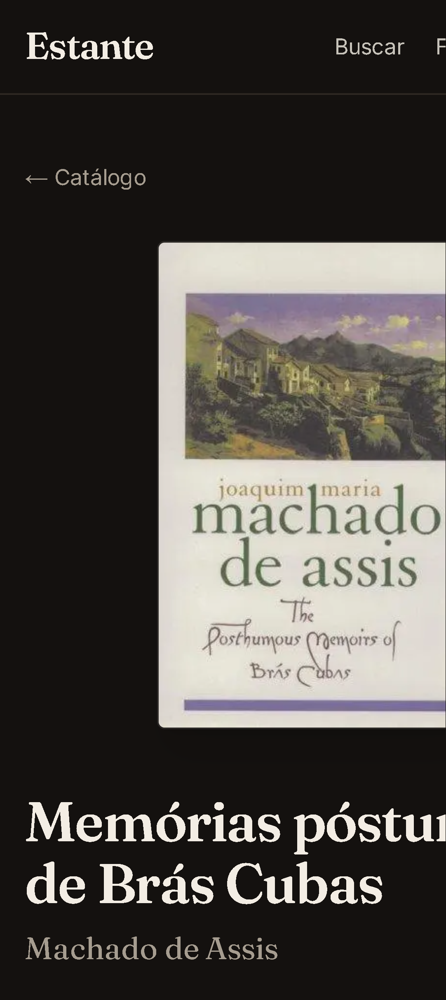
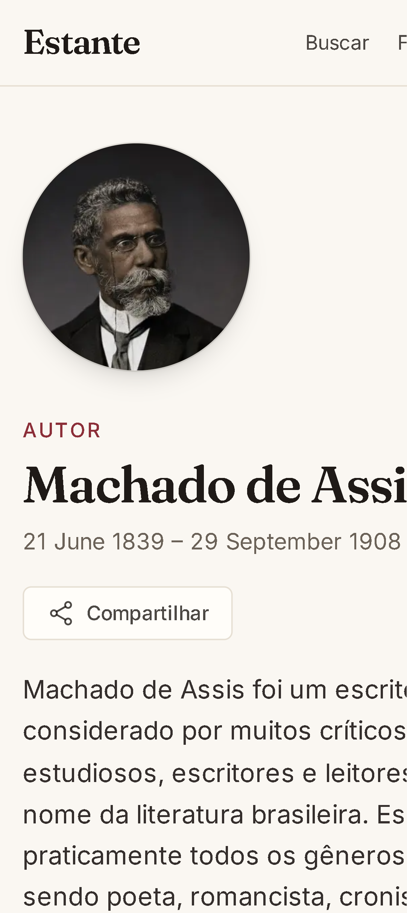

# Estante

[](https://github.com/vidalicaro-byte/estante/actions/workflows/ci.yml)
[](https://estante-plum.vercel.app)
[](LICENSE)

**English** · [Português](#estante-pt-br)

A book catalog for readers, built with Next.js 16 and the [Open Library](https://openlibrary.org) API. Search millions of titles, browse by genre, read about authors and save favorites. The interface is in Brazilian Portuguese, with a curated focus on Brazilian and classic literature.

**Live demo: [estante-plum.vercel.app](https://estante-plum.vercel.app)**

|                                         Light                                          |                                         Dark                                         |
| :------------------------------------------------------------------------------------: | :----------------------------------------------------------------------------------: |
|  |  |
|        |   |

## Features

- **Search and browse**: full-text search, nine genre pages and a curated **Classics** page with one shelf per author.
- **Book and author pages**: covers, descriptions, subjects and biographies. Biographies come in several languages, so the app detects the language and shows the Portuguese text first.
- **Favorites**: saved in the browser, instantly updated everywhere, no account needed.
- **Sharing**: the native share sheet on phones, a copied clean link on desktop.
- **Light and dark themes**, applied before first paint so there is no flash.
- **Built for sharing and search**: per-page metadata, Open Graph previews (book covers, author photos and a generated site image), JSON-LD for books, sitemap and robots.

## Tech stack

|               |                                                                         |
| ------------- | ----------------------------------------------------------------------- |
| Framework     | Next.js 16 (App Router, Turbopack), React 19                            |
| Language      | TypeScript (strict)                                                     |
| Styling       | Tailwind CSS v4 with semantic design tokens, Fraunces and Inter         |
| Data          | Open Library API, validated with Zod                                    |
| Tests         | Vitest (unit), Playwright (end-to-end), axe-core (accessibility)        |
| Tooling       | ESLint, Prettier, Husky, lint-staged, commitlint (Conventional Commits) |
| CI and deploy | GitHub Actions, Vercel                                                  |

## Engineering highlights

**Rendering with Cache Components.** Data fetching lives in `"use cache"` functions with explicit lifetimes (hours for searches, days for books and authors). Pages stream their dynamic parts inside `Suspense`, so the static shell is served immediately. Featured books and authors are prerendered at build time; the rest are rendered on demand and cached.

**A defensive API client** (`src/lib/open-library/`). Open Library is a free third-party service, so the client assumes it will misbehave: per-request timeouts, retries with backoff, rate limiting that honors `Retry-After` on HTTP 429, typed errors, and Zod schemas for every response. It also copes with the API's quirks: optional fields, `-1` cover ids, text that is sometimes a string and sometimes `{ type, value }`, and basic markdown in biographies.

**Failing loudly on purpose.** Statically generated components do not swallow API errors, because a caught error would be baked into the HTML and cached. A failed build never replaces the live site, and CI retries the build when the API is flaky.

**Favorites with `useSyncExternalStore`.** Favorites live in `localStorage` and are read through an external store, so every component stays in sync and server and client renders do not mismatch. Stored data is treated as untrusted and validated with Zod.

**Accessibility as a tested property.** A skip link, `aria-pressed` toggles, live regions for status messages, and visible focus styles. End-to-end tests run axe-core on the main pages in both themes, and a test guards the card layout so the favorite button never triggers the card link (a stacking-context bug that regressed twice).

## Quality

- **Unit tests** cover the API client, mappers, text handling, pagination, favorites and sharing.
- **End-to-end tests** (Playwright, Chromium) cover favorites, navigation, the skip link, sharing and WCAG A/AA scans in light and dark themes.
- **CI** runs format check, lint, type check, unit tests and a production build, then the end-to-end tests in a separate job.
- **Lighthouse (mobile, median of three runs, production):** Accessibility 100, Best Practices 100, SEO 100. Performance is about 75 on the home page and 72 on book pages. The main remaining cost is JavaScript hydration on a throttled CPU, which is the next thing to investigate.

## Getting started

Requires Node.js 24 (see `.nvmrc`).

```bash
git clone https://github.com/vidalicaro-byte/estante.git
cd estante
npm install
npm run dev
```

Open [http://localhost:3000](http://localhost:3000). No API key or environment variables are needed.

| Script              | What it does                                 |
| ------------------- | -------------------------------------------- |
| `npm run dev`       | Development server                           |
| `npm run build`     | Production build                             |
| `npm run start`     | Serve the production build                   |
| `npm run lint`      | ESLint                                       |
| `npm run typecheck` | Generate route types and run `tsc`           |
| `npm test`          | Unit tests                                   |
| `npm run test:e2e`  | End-to-end tests (run `npm run build` first) |
| `npm run format`    | Format with Prettier                         |

## Project structure

```
src/
  app/                 Routes: home, search, books, authors, genres, favorites
  components/          UI components
  lib/
    open-library/      API client, schemas, mappers, text and language helpers
    ...                Genres, shelves, favorites store, SEO helpers
e2e/                   Playwright tests
scripts/               CI helpers
```

## Roadmap

- Reduce hydration cost on mobile (bundle analysis first).
- Format author dates in Portuguese.
- Clean up the remaining markdown edge cases in biographies (single-asterisk emphasis).
- Optional accounts, to sync favorites between devices.

## Data and credits

Book data and covers come from [Open Library](https://openlibrary.org), a project of the [Internet Archive](https://archive.org). Estante is an independent project and is not affiliated with either.

## License

[MIT](LICENSE)

---

<a id="estante-pt-br"></a>

# Estante (PT-BR)

[English](#estante) · **Português**

Um catálogo de livros para leitores, feito com Next.js 16 e a API do [Open Library](https://openlibrary.org). Busque entre milhões de títulos, navegue por gênero, conheça os autores e guarde seus favoritos. A interface é em português do Brasil, com curadoria voltada à literatura brasileira e aos clássicos.

**Demonstração: [estante-plum.vercel.app](https://estante-plum.vercel.app)**

## Funcionalidades

- **Busca e navegação**: busca por texto, nove gêneros e uma página de **Clássicos** com uma prateleira por autor.
- **Páginas de livros e autores**: capas, descrições, assuntos e biografias. As biografias vêm em vários idiomas, então o app detecta o idioma e mostra primeiro o texto em português.
- **Favoritos**: guardados no navegador, atualizados na hora em todos os lugares, sem precisar de conta.
- **Compartilhamento**: a folha de compartilhamento nativa no celular e um link limpo copiado no computador.
- **Temas claro e escuro**, aplicados antes da primeira renderização para não piscar.
- **Pronto para buscadores e redes sociais**: metadados por página, pré-visualizações Open Graph (capas de livros, fotos de autores e uma imagem gerada para o site), JSON-LD para livros, sitemap e robots.

## Tecnologias

- **Framework:** Next.js 16 (App Router, Turbopack) e React 19
- **Linguagem:** TypeScript em modo estrito
- **Estilos:** Tailwind CSS v4 com tokens de design semânticos, Fraunces e Inter
- **Dados:** API do Open Library, validada com Zod
- **Testes:** Vitest (unitários), Playwright (ponta a ponta) e axe-core (acessibilidade)
- **Ferramentas:** ESLint, Prettier, Husky, lint-staged e commitlint (Conventional Commits)
- **CI e deploy:** GitHub Actions e Vercel

## Destaques de engenharia

**Renderização com Cache Components.** A busca de dados fica em funções `"use cache"` com tempos de vida explícitos (horas para buscas, dias para livros e autores). As partes dinâmicas das páginas chegam em `Suspense`, então a estrutura estática é entregue de imediato. Livros e autores em destaque são gerados no build; os demais são renderizados sob demanda e ficam em cache.

**Um cliente de API defensivo** (`src/lib/open-library/`). O Open Library é um serviço gratuito de terceiros, então o cliente presume que ele vai falhar: timeouts por requisição, novas tentativas com espera crescente, limitação de taxa que respeita o `Retry-After` do HTTP 429, erros tipados e schemas Zod para cada resposta. Ele também lida com as peculiaridades da API: campos opcionais, ids de capa `-1`, textos que ora são string e ora são `{ type, value }`, e markdown básico nas biografias.

**Falhar alto, de propósito.** Componentes gerados estaticamente não engolem erros da API, porque um erro capturado seria gravado no HTML e ficaria em cache. Um build que falha nunca substitui o site no ar, e o CI repete o build quando a API está instável.

**Favoritos com `useSyncExternalStore`.** Os favoritos ficam no `localStorage` e são lidos por um store externo, então todos os componentes ficam sincronizados e não há divergência entre servidor e cliente. Os dados guardados são tratados como não confiáveis e validados com Zod.

**Acessibilidade como propriedade testada.** Link para pular ao conteúdo, botões com `aria-pressed`, regiões vivas para mensagens de status e foco visível. Os testes de ponta a ponta rodam o axe-core nas páginas principais nos dois temas, e um teste protege o layout do card para que o botão de favorito nunca acione o link do card (um bug de contexto de empilhamento que voltou duas vezes).

## Qualidade

- **Testes unitários** cobrem o cliente da API, os mapeadores, o tratamento de texto, a paginação, os favoritos e o compartilhamento.
- **Testes de ponta a ponta** (Playwright, Chromium) cobrem favoritos, navegação, o link de pular, o compartilhamento e varreduras WCAG A/AA nos temas claro e escuro.
- **CI** roda a checagem de formato, lint, checagem de tipos, testes unitários e build de produção, e depois os testes de ponta a ponta em um job separado.
- **Lighthouse (mobile, mediana de três execuções, produção):** Acessibilidade 100, Boas práticas 100, SEO 100. Desempenho em torno de 75 na home e 72 nas páginas de livro. O principal custo que sobra é a hidratação de JavaScript em CPU limitada, que é o próximo ponto a investigar.

## Como rodar

Requer Node.js 24 (veja o `.nvmrc`).

```bash
git clone https://github.com/vidalicaro-byte/estante.git
cd estante
npm install
npm run dev
```

Abra [http://localhost:3000](http://localhost:3000). Não é preciso chave de API nem variáveis de ambiente. Os outros scripts (`build`, `lint`, `typecheck`, `test`, `test:e2e`) estão na tabela da seção em inglês.

## Dados e créditos

Os dados e as capas dos livros vêm do [Open Library](https://openlibrary.org), um projeto do [Internet Archive](https://archive.org). O Estante é um projeto independente, sem afiliação com nenhum dos dois.

## Licença

[MIT](LICENSE)
